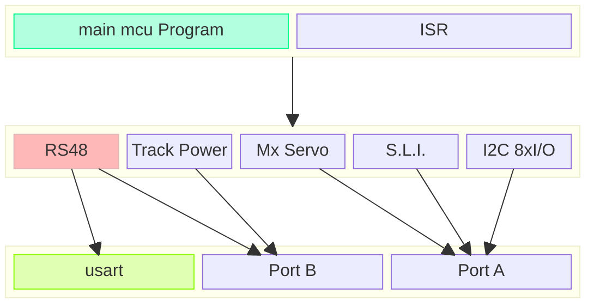

# Repo Organistion

## Décision

Un seul repo Git, **monorepo** avec npm workspaces (pas pnpm — simplicité avant perf), **3 packages à plat** à la racine (pas de dossier `packages/` intermédiaire) :

```
dcc-control-app/
  package.json              # racine : workspaces: [shared-contracts, gateway, frontend]
  tsconfig.base.json         # config TS commune
  .gitignore
  .nvmrc                     # fige la version de Node (contrainte Angular CLI récent)
  shared-contracts/
    package.json             # name: "@rwn/shared"
    tsconfig.json
    src/
      index.ts                # point d'entrée — DOIT relayer tous les sous-modules via export *
      ws-messages.ts
      dto/
      utils.ts
  backend/
    package.json
    tsconfig.json             # module/moduleResolution: NodeNext
    src/
      index.ts
      websocket-server.ts
      discovery/
      session/
      transport/
      framing/
      protocol/
      domain/
      mappers/
      config/
  frontend/                   # généré via `ng new`, puis intégré au workspace
    package.json
    angular.json
    src/
```

## Pourquoi monorepo (pas repos séparés)

- Un seul package `@rwn/shared` consommé par `gateway` ET `frontend` sans publication sur registre — simple lien symbolique `node_modules/@rwn/shared → shared-contracts/`.
- Changements atomiques : modifier un DTO touche souvent les deux côtés en même temps.
- Projet solo — les bénéfices de repos séparés (équipes/cycles de release indépendants) ne s'appliquent pas.



## Pièges rencontrés en pratique (à ne pas reproduire)

> [!warning] Erreurs vécues pendant la mise en place
> 1. **`workspace:*`** est une syntaxe pnpm/Yarn — avec npm workspaces, utiliser simplement `"*"` comme version de dépendance interne.
> 2. **`npm install` depuis un sous-dossier** ne voit pas les `workspaces` racine — toujours lancer depuis `dcc-control-app/`.
> 3. **Extensions `.js` obligatoires** sur les imports relatifs dans `gateway` (et dans `shared-contracts` une fois compilé) à cause de `moduleResolution: NodeNext` — y compris dans les `export * from './xxx.js'` de `index.ts`. Angular/esbuild tolère l'absence d'extension (mode `Bundler`), **Node en ESM strict ne la tolère pas** : c'est la cause la plus fréquente de `ERR_MODULE_NOT_FOUND` rencontrée.
> 4. **`__dirname`/`__filename` n'existent pas en ESM** — remplacer par `fileURLToPath(import.meta.url)` + `dirname(...)`.
> 5. **`index.ts` doit relayer EXPLICITEMENT chaque sous-module** (`export * from './dto/xxx.dto.js'`) — un nouveau DTO ajouté dans son propre fichier mais oublié dans `index.ts` reste invisible depuis `@rwn/shared`, même si le fichier compile sans erreur isolément.
> 6. Toute interface/type/classe destinée à être utilisée en dehors de son fichier source doit être préfixée par `export` — en TypeScript, l'oubli ne lève pas toujours d'erreur évidente selon le contexte.

## Résolution de `@rwn/shared` : deux modes possibles

- **Mode "build"** (robuste, recommandé à terme) : `shared-contracts` compile vers `dist/`, `package.json` pointe `main`/`types` vers `dist/index.js`/`dist/index.d.ts`. Nécessite `npm run build` à chaque changement (ou `tsc --watch`).
- **Mode "alias direct vers les sources"** (confort en dev) : `paths` dans `tsconfig.json` de `gateway`/`frontend` pointant vers `shared-contracts/src/index.ts`. Fonctionne nativement avec `tsx` (gateway) et esbuild (Angular) sans étape de build intermédiaire.

## Démarrage en dev

```bash
# terminal 1
cd gateway && npm run dev      # tsx watch src/index.ts

# terminal 2
cd frontend && npm start        # ng serve --host 0.0.0.0 (pour écoute réseau)
```

## Scripts clés

| Package | Script | Rôle |
|---|---|---|
| `shared-contracts` | `build` / `dev` | `tsc` / `tsc --watch` |
| `gateway` | `dev` | `tsx watch src/index.ts` — résout les imports TS à la volée, pas de build intermédiaire |
| `frontend` | `start` | `ng serve --host 0.0.0.0` |

> [!note] En-tête de fichier
> Convention retenue pour les fichiers du projet : nom du projet, description courte, licence, auteur, **et une mention explicite de l'assistance IA** (Claude/Anthropic) avec un rappel honnête qu'aucune recherche documentaire live n'a été effectuée en session — connaissances générales du modèle uniquement — plus une liste de références de domaine à consulter pour validation (NMRA S9.1/S9.2/S9.2.1/S9.2.2, RailCommunity LocoNet, Lenz XpressNet, RFC 1055, MDN Web Serial/WebSocket, GoF Design Patterns).
