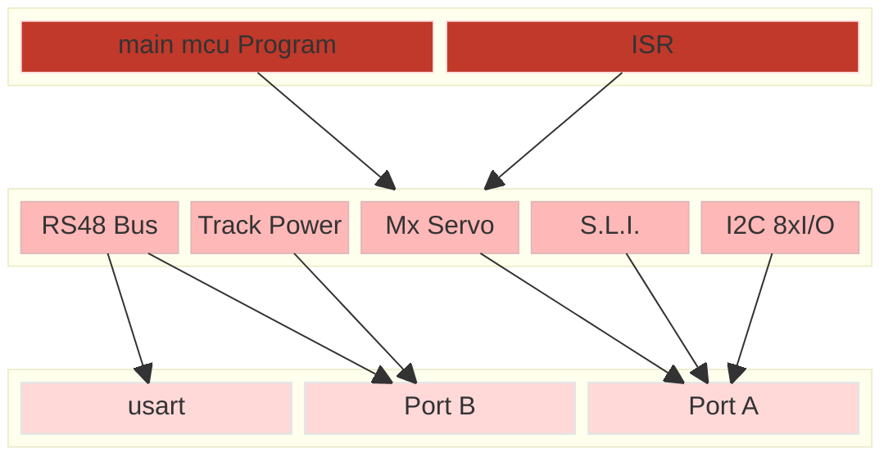

# Modular Architecture

## hardware module layer





- Main loop rule: `if (RWNBUS_FRAME_READY()) { dccDecoder_Task(rwnBus_Packet, rwnBus_PacketLength);  RWNBUS_RELEASE(); }`
- Stack measured at 3 (main side) + 3 (interrupt side) = 6/8, from the map and hex file.
- Main loop pass must stay **below ~700 µs** (silence detection is 1280 µs minimum).
- Pins: RB1 = RX, RB2 = TX, RB0 = RS485 driver enable, RA0/RA1 = SLI LEDs, RA2/RA3 = SDA/SCL, RA4 = I/O direction, RB7 = servo signal (also PGD), RB6 = PGC, RA5 = simple input (MCLRE off).
- MPLAB project `RwnBoardFirmware`: configurations `StarterBoard` (Simulator) and `SignalDecoder`; outputs in `out/` and `_build/`; a post-build step runs `mapreport.py` and writes `docs/<config>_mem_report.md`.
## Repo Organisation

Only one repo Git, **monorepo**   for firmware and hardware. schematics and PCB are included in this global Microchip VsCode project. firmware and hardware still up to date. 

In this organisation modular approche split specific firmware parts and reusable modules driver code.

```
core/                             # Generic firmware bases function
	isr.c/.h
	dccDecoder.c/.h
decoders/                         # Board specific firmware parts
	RwnSarterBoard/
		HardwareProfile.h         # Hardware definition
		main.c                    # Main firmware code
	RwnSignalDecoder/
		...
docs/                             # Sources of this doc 
mcu/
		mcu_pic16f628a.h          # Specific definition for target hw
modules/
	ResetBtn.c/.h
	SystemLEDIndicator.c*.h
	...
test/                             # Data for testing board
.git
.github/
.vscode/
	workflows/deploy-gh-pages.yml  # CI jobs definition for GitHub Pages 
```


