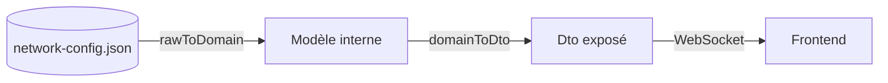

# Conventions de nommage

## Les trois représentations d'une même entité

Convention centrale du projet, pour ne plus se perdre entre "ce que lit le fichier", "ce que manipule la gateway" et "ce qu'on expose au frontend" :

| Préfixe/suffixe | Rôle | Exemple | Emplacement |
|---|---|---|---|
| `RawConfig<Nom>` | miroir fidèle du JSON de config | `RawConfigAccessPoint` | `gateway/src/config/raw/` |
| `<Nom>` (sans suffixe) | modèle interne gateway | `AccessPoint`, `Accessory` | `gateway/src/domain/` |
| `<Nom>Dto` | exposé au frontend via WebSocket | `AccessPointDto`, `AccessoryDto` | `shared-contracts/src/dto/` |

Le passage d'une représentation à l'autre se fait **uniquement** via des mappers dédiés :



- `gateway/src/mappers/raw-to-domain.ts`
- `gateway/src/mappers/domain-to-dto.ts`

> [!important] Règle stricte
> Un objet ne doit jamais passer directement de `RawConfig*` à `*Dto` sans transiter par le modèle interne — même quand les deux mappers semblent redondants pour un cas simple. Ça garde un point de passage unique si `raw` et `domain` divergent un jour (ex: renommage `networkName` → `label` déjà rencontré).

## Suffixe `Dto` systématique côté `shared-contracts`

Toute interface exposée côté frontend porte le suffixe `Dto` — y compris les interfaces de base :
`AccessoryBaseDto` (pas `AccessoryBase`), `LocomotiveDto`, `ZoneDto`, etc.

## Discriminant d'union : `family` (pas `type` ni `kind`)

Choix final, après discussion :
- `type` écarté : déjà utilisé comme discriminant des messages WebSocket (`{ type: 'discovery:scan' }`), risque d'ambiguïté si les deux se croisent dans le même contexte.
- `kind` proposé initialement (convention TS courante, ex: AST du compilateur TypeScript) — jugé "bizarre" à l'usage.
- **`family` retenu** : analogie avec les familles de composants électroniques (cohérent avec le monde décodeurs/cartes du projet).

```typescript
export interface AccessoryDto {
  id: string;
  label: string;
  family: string;   // 'turnout' | 'signal' | 'turntable' | 'crossing' | ... — ouvert, pas une union fermée
  value: AccessoryValueDto;
}
```

## Direction / sens de circulation : `increasing` / `decreasing` / `bidirectional`

Deux conventions candidates discutées :
1. `normal` / `reverse` (vocabulaire courant en modélisme digital — proche de Rocrail/JMRI)
2. `increasing` / `decreasing` (lié au kilométrage/PK de la ligne)

**Retenu : option 2**, car auto-porteur (n'importe qui lit le code sans connaître une convention externe) et cohérent avec une future notion de position/distance sur la voie.

> Le numéro de zone croît avec le PK, mais pas nécessairement de façon régulière :
> `z7 → z9 → z11[voie 1, km 484] → z15 → z19 → z25[km 485]`

Voir aussi [[04-Modele-Domaine-Config#Zone]] pour le détail (`bidirectional` pour les voies de garage).

> [!note] Convention écartée consciemment
> Un temps envisagé : nommer la direction d'après la géographie réelle (`toParis`/`toProvince`). **Écarté** : coder en dur une référence géographique/historique (SNCF, sens de construction du réseau) lie la sémantique du code à un contexte qui peut ne plus faire sens après travaux, changement de réseau modélisé, etc.

## Discriminant des valeurs d'accessoire : `valueKind`

`range` / `enum` / `flags` — voir [[05-Accessory-Generique]].

## Identifiants d'options : `id` (string), jamais de valeur numérique protocole exposée

Pour les `enum`/`flags`, chaque option porte un `id: string` stable (`"straight"`, `"diverging"`, `"on"`...), jamais la valeur numérique brute du protocole (aspect DCC, bit de flag). La traduction `id → valeur protocole` reste interne à la gateway (`AccessoryControl.aspectMap`).

Raison : éviter de reproduire le couplage déjà écarté pour `Locomotive.decoderAddress` (voir [[04-Modele-Domaine-Config]]) — une valeur numérique de protocole qui fuite dans le DTO est fragile (recalibration = casse le frontend) et illisible en debug WebSocket.
