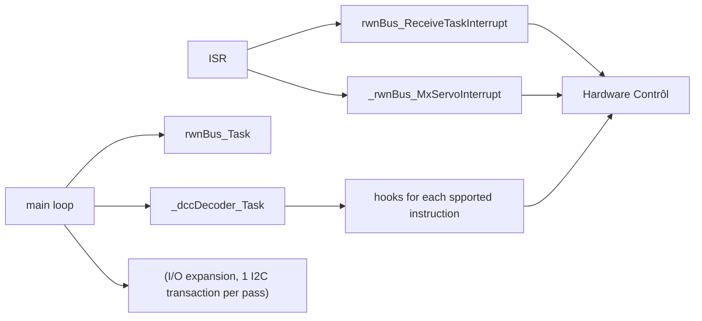

# Conventions and Rules

## Capabilities 
Capabilities are macros in `HardwareProfile.h`: `DCC_MF_*` (multifunction) and `DCC_ACC_*` (accessory) can never be mixed. A disabled block generates no code and needs no hook; a missing hook is a link error.

## Hardware names
Hardware names (pins, TRIS, baud, masks) always come from `HardwareProfile.h`, with `#error` checks. No hard-coded pins.

## Naming
- function : `module_Function()`
- macros `MODULE_NAME`
- types like `DccPacket`.

## Packet format
For serial protocol , the packet format is : `>>>` header (stripped), then address, instruction, data…, XOR; the XOR of all bytes is 0; length 3–6.

## Stack level limitation rule
Lleaf functions, one monolithic `dccDecoder_Task`, no modulo in the ISR chain, ≤ 2 levels under main for new modules.

##  Shared variables
Single writer; `volatile` only for ISR-shared data. `unsigned char` rather than `bit` (clangd does not know `__bit`); flags will move to the author’s bitfield struct.

> [!important]  '__bit'
>clangd limitation is fixed.  There is no more limitation for `__bit` use.

## PIC specifics

`CMCON = 0x07` for digital RA0–RA3; 
PORTA has no LAT register, so a shadow register `sh_porta` is used and the bits of SDA, SCL and DIR must stay 0 in it; open-drain lines are emulated through TRIS.

## References

> [!note] Files header
> Writing rules for file header content of project Files : project name, brief description , license, autor, **a IA reference for his work review and help** (Claude/Anthropic) with the IA processing note : 
> - No online research 
> - Drawing on the model's general knowledge
> - Final implementation, validation against real hardware, and design decisions remain the author's responsibility

