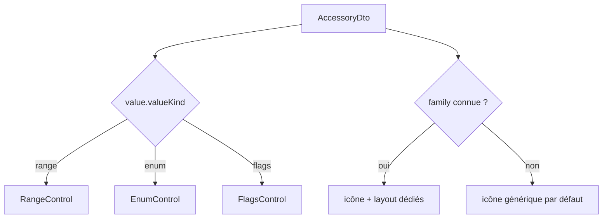

# Modèle générique d'accessoire — extensibilité sans recompilation

## Problème posé

Approche initiale : un DTO par type d'accessoire (`SignalDto`, `TurnoutDto`, `LightDto`...). Limite identifiée : ajouter un nouveau type (`TurnTableDto`, `CrossingDto`) demanderait du code frontend **et** backend à chaque fois.

## Principe retenu

Découpler la **couche technique** (comment on interagit avec la valeur) de la **couche visuelle** (comment on l'affiche). La couche technique devient entièrement générique, fermée sur 3 formes de valeur.

## Les 3 formes de valeur (`valueKind`)

```typescript
export type AccessoryValueDto =
  | { valueKind: 'range'; min: number; max: number; step?: number; value: number }
  | { valueKind: 'enum'; options: { id: string; label: string }[]; selectedId: string }
  | { valueKind: 'flags'; flags: { id: string; label: string }[]; activeIds: string[] };
```

> [!note] Fusion schéma + valeur courante
> Version initiale séparait `valueSchema` (bornes/options) et `currentValue` — redondance du discriminant `valueKind` dans les deux, **et** état invalide représentable (schema=`range` mais currentValue=`enum`). Fusionné en un seul type : un accessoire `range` a *obligatoirement* `min`/`max`/`value` ensemble, par construction du type.

### Type dédié pour les commandes/évènements (delta uniquement)

Le schéma (bornes/options) ne change pas dynamiquement — inutile de le renvoyer à chaque commande :

```typescript
export type AccessoryValueUpdateDto =
  | { valueKind: 'range'; value: number }
  | { valueKind: 'enum'; selectedId: string }
  | { valueKind: 'flags'; activeIds: string[] };
```

## `AccessoryDto` unique

```typescript
export interface AccessoryDto {
  id: string;
  label: string;
  family: string;        // ouvert : 'turnout', 'signal', 'turntable', 'crossing', ... (voir 03-Convention-Nommage)
  value: AccessoryValueDto;
}
```

Un pont tournant devient une simple **entrée de config** (`family: 'turntable'`, `valueKind: 'enum'` avec les positions), pas un nouveau type à coder.

## Cas traités

| Accessoire                            | `valueKind` | Détail                                                                                                                                   |
| ------------------------------------- | ----------- | ---------------------------------------------------------------------------------------------------------------------------------------- |
| Aiguillage simple                     | `enum`      | 2 options (`straight`/`diverging`)                                                                                                       |
| Aiguillage servo (extended accessory) | `enum`      | options = positions pré-calibrées en CV décodeur                                                                                         |
| Pont tournant                         | `enum`      | N options = N voies de garage                                                                                                            |
| Lumière on/off                        | `enum`      | **toujours enum à 2 options** (`on`/`off`), décision explicite — pas de `valueKind: 'boolean'` séparé, pour garder 3 formes au lieu de 4 |
| Signal                                | flags       | flags   => aspects (voie libre, Avertissement,arrêt + ralentissement, ...)                                                               |

> Rendu UI : `EnumControl` peut se rendre comme un simple toggle glissant quand `options.length === 2` (ex: `Éteint <o   > Allumé`) — un détail d'affichage, pas une distinction de modèle.

## Rendu frontend — 2 étages

1. **Contrôle technique** : un seul composant par `valueKind` → `RangeControl`, `EnumControl`, `FlagsControl`. 3 composants suffisent pour tous les accessoires présents et futurs.
2. **Habillage visuel** : table `family → { icône, mise en page }` avec repli générique pour une `family` inconnue — pas de crash, juste une icône par défaut en attendant.



## Cohérence avec les fonctions loco

Le modèle `LocoFunction` ([[04-Modele-Domaine-Config]]) suit déjà implicitement ce même principe (`IndependentFunction` ≈ enum à 2 valeurs, `LogicalFunction` ≈ enum à N états) — piste de convergence identifiée mais non implémentée : réutiliser `AccessoryValueDto`/`AccessoryValueUpdateDto` pour les fonctions loco plutôt qu'une UI dédiée.
