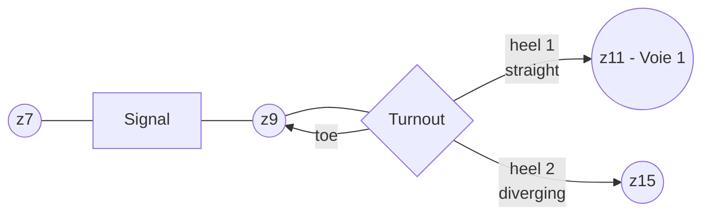

# Topologie réseau — modèle en graphe (backend interne)

> [!warning] Statut
> Discuté en principe, **non implémenté**. Noté pour une session de conception dédiée future.

## Principe

Modèle interne backend en théorie des graphes :
- **Nœuds** : `signal`, `turnout`, `stopblock`, ...
- **Arêtes** : `Zone` (voir [[04-Modele-Domaine-Config#Zone]])



## Signal : relie 2 zones

Un signal est un nœud à la frontière entre deux zones (arêtes) — pas une appartenance à une seule zone.

```typescript
interface TrackNode {
  id: string;
  family: 'signal' | 'turnout' | 'stopblock' | ...;
  adjacentZoneIds: string[];   // 2 pour un signal, 3 pour un turnout
}
```

> [!note] Évolution du modèle `SignalDto`
> `zoneId: string` initialement envisagé sur `SignalDto`, **retiré** — pas de sens réel (le signal relie deux zones, n'appartient à aucune). `presentationDirection` devient potentiellement dérivable de la topologie (sens de circulation *vers* la zone protégée) plutôt qu'un champ hérité d'une zone unique. Point non refermé : le DTO frontend a-t-il besoin d'exposer la topologie, ou seulement le résultat déjà résolu (`presentationDirection` explicite) ? → à trancher avec le reste du modèle de graphe.

## Turnout (aiguillage) : 3 branches à distinguer

Différence fonctionnelle importante pour l'algorithme de parcours :
- **Toe (pointe)** : depuis la pointe, un train peut choisir l'un ou l'autre talon (c'est là que réside le choix straight/diverging).
- **Heels (talons, x2)** : depuis un talon, un seul chemin possible vers la pointe — pas de choix.

```typescript
interface TurnoutNode {
  id: string;
  family: 'turnout';
  toeZoneId: string;
  heelZoneIds: [string, string];   // ordre lié à currentValue (ex: heel[0]=straight, heel[1]=diverging)
}
```

Cette distinction toe/heel conditionne quelles arêtes sont traversables dans quel sens selon l'état courant de l'aiguillage — nécessaire pour tout futur algorithme de recherche d'itinéraire.

## Lien avec `Accessory.feedsZoneIds` (alimentation électrique, distinct de la topologie de circulation)

Un accessoire (ex: relais de coupure) peut alimenter plusieurs zones à la fois — relation différente de la topologie de circulation ci-dessus :

```typescript
interface AccessoryBase {
  // ...
  feedsZoneIds?: string[];   // zones alimentées électriquement, si applicable
}
```

À ne pas confondre avec la relation zone↔secteur (configuration Admin, voir [[04-Modele-Domaine-Config#Sector]]).

## Sujets ouverts pour la suite

- Formaliser complètement `TrackNode`/`TurnoutNode`/`SignalNode` côté `gateway/src/domain/`.
- Décider si/comment ce graphe doit être exposé (partiellement ou pas du tout) au frontend pour le futur TCO.
- Algorithme de recherche d'itinéraire (hors périmètre POC actuel).
