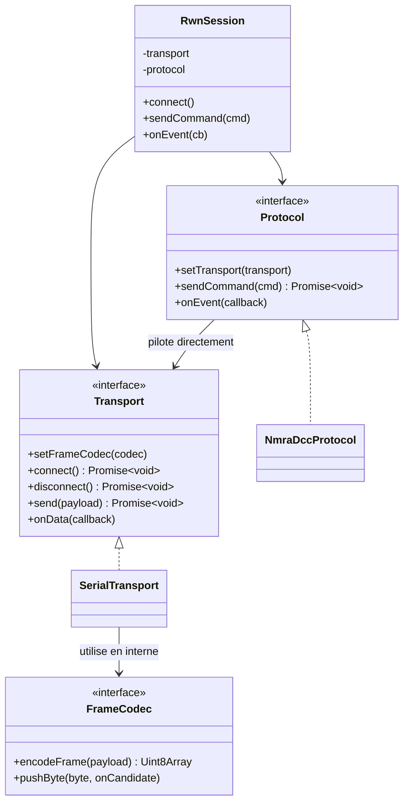

# Communication bas niveau — Transport / FrameCodec / Protocol

## Évolution de l'architecture (importante — ne pas repartir de la première version)

Une première architecture à 3 axes orthogonaux (Transport / FrameCodec / Protocol, composés par une session neutre) a été proposée, puis discutée pour intégrer un éventuel 4ᵉ axe (`ExchangePolicy`, pour la sémantique d'échange propre à chaque protocole — fire-and-forget pour NMRA, scrutation maître-esclave pour XpressNet, détection de collision pour LocoNet).

**Décision finale retenue (différente de la proposition initiale)** :



Points clés de cette version finale :
- **`Protocol::setTransport()`** — le protocole pilote directement le transport (pas l'inverse, pas de médiateur neutre).
- **`SerialTransport::setFrameCodec()`** — le framing est lié au transport, **avant** la création de la session. `Transport.send()`/`onData()` manipulent des **payloads déjà dé-framés/à encadrer** — `Protocol` ne voit jamais de START/END/checksum de trame.
- **Pas d'axe `ExchangePolicy` séparé** — la logique d'échange propre à un protocole (attente d'ACK, retry, détection de collision...) est une **couche de base intégrée au `Protocol`**, pour les protocoles qui en ont besoin (NMRA n'en a pas besoin — fire-and-forget).
- **`RwnSession` devient très mince** : compose transport+protocol à la construction, délègue tout (`sendCommand`, `onEvent`) au `Protocol`. Question ouverte non tranchée : est-ce qu'une classe dédiée apporte encore de la valeur à ce stade, ou un simple objet composé suffirait ? (Garder `RwnSession` laisse un point d'extension futur — logs, métriques, reconnexion — sans toucher `websocket-server.ts`.)

```typescript
export class RwnSession {
  constructor(private transport: Transport, private protocol: Protocol) {
    this.protocol.setTransport(this.transport);
  }
  connect(): Promise<void> { return this.transport.connect(); }
  disconnect(): Promise<void> { return this.transport.disconnect(); }
  sendCommand(cmd: OutgoingCommand): Promise<void> { return this.protocol.sendCommand(cmd); }
  onEvent(callback: (event: IncomingEvent) => void): void { this.protocol.onEvent(callback); }
}
```

## Design patterns identifiés

- **Strategy** : `Protocol` et `Transport` interchangeables indépendamment.
- **Bridge** (esprit conservé même après simplification) : le protocole et le transport varient sur deux axes, composés plutôt qu'hérités.
- **Ports & Adapters / Architecture hexagonale** : le domaine métier (commandes, locos, accessoires) reste agnostique du matériel réel — testable sans port série branché.
- **Registry** (pour la découverte, voir [[08-Contrat-WebSocket]]) : ajouter un protocole = enregistrer un nouvel élément, sans toucher au code de scan existant.

## Framing — spécifique au firmware maison (pas un standard générique)

> [!important] Le framing N'EST PAS une propriété générique du port série
> C'est une propriété du firmware/interface matérielle précise. Un autre firmware (DCC-EX, LocoBuffer...) aurait un framing différent sur le même transport physique.

Décisions retenues, dans l'ordre chronologique de la réflexion :
1. Framing nécessaire car les longueurs de trame varient selon l'instruction NMRA (loco speed, basic accessory, extended accessory...).
2. Choix : préfixe + suffixe de trame plutôt qu'un préfixe de longueur.
3. **Version expérimentale finale** : **START fixe sur 3 octets** (motif répété, ex: `>>>`), **pas de END**. Objectif : réduire la probabilité de collision accidentelle avec le contenu du payload (1/256³ au lieu de 1/256 avec un seul octet START), sans recourir à l'escaping (byte-stuffing façon SLIP).
4. **Le `Protocol` ne reçoit que des paquets "candidats"** (START retiré par le framing), **pas des paquets validés** — la validation du checksum XOR reste de la responsabilité du `Protocol`, pas du framing (le framing ne connaît pas la sémantique NMRA).

```typescript
interface FrameCodec {
  encodeFrame(payload: Uint8Array): Uint8Array;
  pushByte(byte: number, onCandidate: (payload: Uint8Array) => void): void;
}
```

> [!warning] Point de vigilance non refermé
> Sans END, la fin d'une trame n'est connue qu'à l'arrivée du START suivant — la **dernière trame d'un flux reste en attente** tant qu'aucun START suivant n'arrive. Nécessite soit un flush par timeout, soit la garantie firmware qu'une trame suivante (même un keep-alive) arrive toujours à intervalle régulier. **Non tranché à date de rédaction.**

## Encodage NMRA — exemples concrets (S9.2.1)

### Structure générale d'un paquet

`[Byte Adresse] [Byte(s) Instruction] [Byte Checksum = XOR de tous les bytes précédents]`

```typescript
function checksum(bytes: number[]): number {
  return bytes.reduce((acc, b) => acc ^ b, 0);
}
```

### Vitesse/direction loco — instruction "128 Speed Step"

`[Adresse] 0011-1111 [DDDDDDDD]` — 2ᵉ byte fixe `0x3F`, 3ᵉ byte : bit 7 = direction, bits 0-6 = vitesse (0=stop, 1=e-stop, 2-127=vitesse).

```typescript
function encodeLocoSpeed(cmd: { address: number; speed: number; direction: 'forward' | 'reverse' }): Uint8Array {
  const addressByte = cmd.address & 0xFF;
  const instructionByte = 0b00111111;
  const directionBit = cmd.direction === 'forward' ? 1 : 0;
  const speedByte = (directionBit << 7) | (cmd.speed & 0x7F);
  const bytes = [addressByte, instructionByte, speedByte];
  return new Uint8Array([...bytes, checksum(bytes)]);
}
```

Exemple tracé : `{address: 3, speed: 95, direction: 'forward'}` → `Uint8Array [0x03, 0x3F, 0xDF, checksum]`.

> [!note] "150 km/h" n'est jamais envoyé tel quel
> Le protocole ne transporte qu'un pas de vitesse normalisé (0-127). La conversion km/h → pas de vitesse dépend de la calibration du décodeur (CV5/CV6 — Vmax) — sujet non traité, à prévoir côté admin/calibration loco si besoin d'affichage en km/h.

### Basic Accessory Decoder Packet

`10AAAAAA 1AAACDDD` (notation approximative — **des sources divergent légèrement sur l'ordre exact `C`/`D`/`D`/dernier bit** ; à valider contre le firmware réel) :

```typescript
function packByte(fields: { value: number; bits: number }[]): number {
  let byte = 0;
  for (const { value, bits } of fields) byte = (byte << bits) | (value & ((1 << bits) - 1));
  return byte;
}

function encodeBasicAccessory(cmd: { address: number; output: number; activate: boolean }): Uint8Array {
  const lowBits = cmd.address & 0x3F;
  const highBitsInverted = (~(cmd.address >> 6)) & 0x07;
  const byte1 = packByte([{ value: 0b10, bits: 2 }, { value: lowBits, bits: 6 }]);
  const byte2 = packByte([
    { value: 1, bits: 1 },
    { value: highBitsInverted, bits: 3 },
    { value: cmd.activate ? 1 : 0, bits: 1 },
    { value: cmd.output & 0x03, bits: 2 },
    { value: 0, bits: 1 },
  ]);
  const bytes = [byte1, byte2];
  return new Uint8Array([...bytes, checksum(bytes)]);
}
```

### Extended Accessory Decoder Control Packet

`10AAAAAA 0AAA0AA1 000XXXXX` — 3 bytes, aspect sur 5 bits (0-31) dans le 3ᵉ byte.

### Pourquoi "4 sorties" pour un basic accessory decoder

Voir [[04-Modele-Domaine-Config#Decoder]] — la règle vient de la structure des bits (2 bits = 4 combinaisons), pas explicitement du texte S9.2.1 §2.4.1 lui-même.

## `SerialTransport` — implémentation (lib `serialport`)

```bash
npm install serialport
```

Points d'implémentation retenus :
- `autoOpen: false` + `open()` explicite pour capturer proprement l'erreur d'ouverture (port occupé, chemin inexistant).
- `port.write()` **puis** `port.drain()` avant de résoudre `send()` — `write()` seul résout dès la mise en buffer, pas l'émission réelle sur le fil. Important pour la sérialisation des commandes (voir [[10-Asynchronicite-et-Robustesse]]).
- `'close'` (fermeture propre, volontaire) distinct de `'error'` (coupure physique inattendue) → états `disconnected` vs `error`, pour que la couche supérieure décide (retry auto ou pas).
- `ERR_MODULE_NOT_FOUND` côté ESM : remplacer `__dirname` par `fileURLToPath(import.meta.url)` (voir [[02-Modular Architecture]]).

## Points non implémentés / en attente

- `LocoNetProtocol`, `XpressNetProtocol`, `TcpTransport` : stubs seulement (`throw new Error('non implémenté')`).
- `decode()` du `Protocol` (retours capteurs/état) : signature posée, contenu réel non écrit.
- Timeout de flush pour le framing sans END (voir plus haut).


## Composition d'une session à partir d'un AccessPoint

`createSession(accessPoint)` reçoit le modèle interne résolu via l'`AccessPointRegistry` (voir [[08-Contrat-WebSocket#Registre des AccessPoint (`AccessPointRegistry`)]]) et assemble les trois couches. Le framing est lié au transport **avant** la création de la session, et c'est `RwnSession` qui relie le protocole au transport.

```typescript
export function createSession(ap: AccessPoint): RwnSession {
  const transport = createTransport(ap);              // selon ap.connectionParams.kind
  transport.setFrameCodec(createFrameCodec(ap));      // framing lié au transport, en amont
  const protocol = createProtocol(ap);                // selon ap.protocol
  return new RwnSession(transport, protocol);         // le constructeur appelle protocol.setTransport(transport)
}
```

| Fabrique | Entrée | Cas gérés |
|---|---|---|
| `createTransport` | `ap.connectionParams.kind` | `serial` : `SerialTransport` ; `lan` : non implémenté |
| `createProtocol` | `ap.protocol` | `RwnNMRA` : `NmraDccProtocol` ; `RwnLocoNet` / `RwnXpressNet` : non implémentés |
| `createFrameCodec` | `ap` | un seul framing pour l'instant (START 3 octets, sans END) |

Pas de fabrique `createExchangePolicy` : la logique d'échange est intégrée au `Protocol` (voir plus haut).