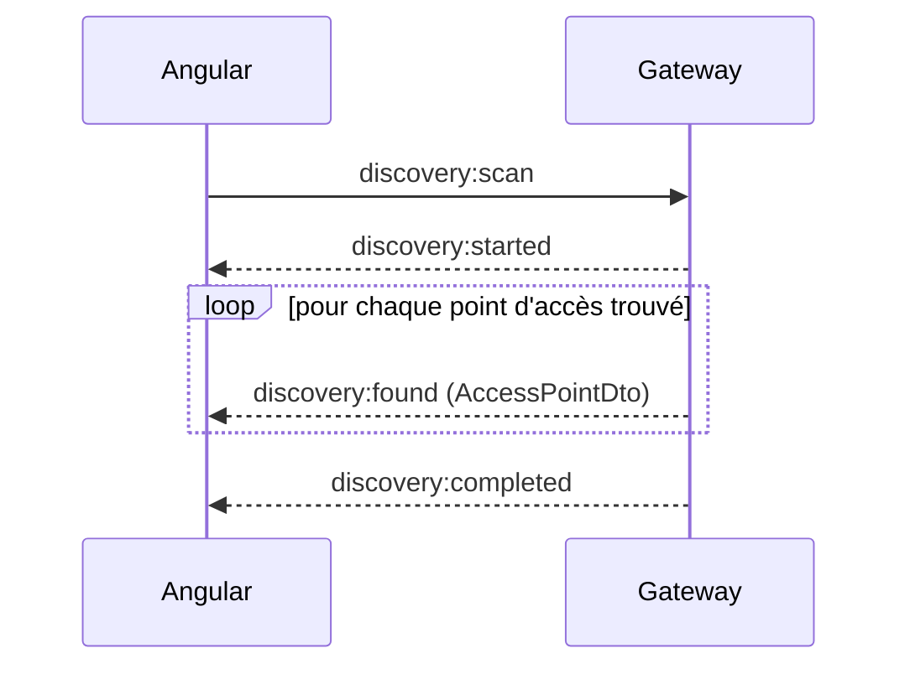
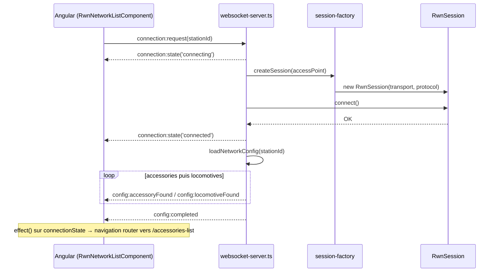
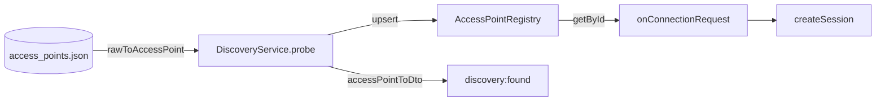

# Contrat WebSocket — gateway ↔ frontend

## Principe général : streaming plutôt que snapshot bloquant

Première version envoyait des listes complètes en un seul message (`discovery:result` avec tout le tableau). **Changement de principe** après avoir anticipé qu'un scan LAN réel pourrait durer plusieurs dizaines de secondes : passage à des **évènements unitaires**, un par élément trouvé, plutôt qu'une attente silencieuse suivie d'un affichage d'un coup.



Implémenté côté backend via **async generator** :

```typescript
async *probe(): AsyncGenerator<AccessPointDto> {
  const entries = await this.readEntries();
  for (const [i, entry] of entries.entries()) {
    await sleep(400);   // simule un contrôle de présence — à remplacer par un vrai test
    try { yield toAccessPoint(entry, i); }
    catch (err) { console.error((err as Error).message); }
  }
  // TODO scan LAN : même principe, yield chaque AccessPoint dès qu'il répond
}
```

```typescript
private async onScan(ws: WebSocket): Promise<void> {
  this.send(ws, { type: 'discovery:started' });
  for await (const ap of this.discovery.probe()) {
    this.send(ws, { type: 'discovery:found', accessPoint: ap });
  }
  this.send(ws, { type: 'discovery:completed' });
}
```

Même principe appliqué au chargement de la config réseau après connexion (`config:accessoryFound` / `config:locomotiveFound` / `config:completed`) — accessoires **avant** locomotives (ordre demandé explicitement).

> [!note] Pourquoi deux canaux séparés (accessory/locomotive) plutôt qu'un seul générique
> Anticipation du filtrage par rôle (voir [[01-Vision-et-Contexte]]) : un **Operator** ne recevrait à terme que `config:locomotiveFound`, un **Manager/Admin** recevrait les deux. Pas encore implémenté, mais le contrat est déjà structuré pour.

## Messages — `ClientMessage` → `ServerMessage` (noms définitifs : `RwnClientMessage`/`RwnServerMessage`)

```typescript
export type RwnClientMessage =
  | { type: 'discovery:scan' }
  | { type: 'connection:request'; stationId: string }
  | { type: 'connection:disconnect' }
  | { type: 'command:setLocoSpeed'; locoId: string; speedStep: number; direction: EDirection }
  | { type: 'command:setAccessory'; accessoryId: string; update: AccessoryValueUpdateDto };

export type RwnServerMessage =
  | { type: 'discovery:started' }
  | { type: 'discovery:found'; accessPoint: AccessPointDto }
  | { type: 'discovery:completed' }
  | { type: 'connection:state'; state: 'disconnected' | 'connecting' | 'connected' | 'error'; stationId?: string }
  | { type: 'config:accessoryFound'; accessory: AccessoryDto }
  | { type: 'config:locomotiveFound'; locomotive: LocomotiveDto }
  | { type: 'config:completed' }
  | { type: 'event:locoSpeedChanged'; locoId: string; speedStep: number; direction: EDirection }
  | { type: 'event:accessoryValueChanged'; accessoryId: string; update: AccessoryValueUpdateDto }
  | { type: 'event:zoneOccupancyChanged'; zoneId: string; occupancy: EOccupancyState }
  | { type: 'error'; message: string; accessoryId?: string };
```

> [!note] Vocabulaire `AccessPoint` (pas `DiscoveredStation`)
> Renommé en cours de route — `stations` dans certains messages est un reliquat historique à harmoniser en `accessPoints` si besoin de cohérence totale.

## Workflow complet : sélection d'un point d'accès → connexion → config



## Résolution d'un `AccessPoint` par id

`DiscoveryService` ne fait actuellement que **lister** (`probe()`). Un manque identifié : il faut une méthode de résolution par id (`getById(stationId)`) pour `onConnectionRequest` — soit en re-scannant puis filtrant, soit en gardant en cache les derniers résultats de scan.[[08-Contrat-WebSocket#Registre des AccessPoint (`AccessPointRegistry`)]]


## Format du fichier `access_points.json` (format "humain", traduit par un mapper)

Le fichier réel ne respecte pas directement le DTO — un mapper traduit :

```json
[
  {
    "networkName": "Montbéliard",
    "protocol": "rwn_nmra",
    "transportType": "serial",
    "connectionParams": { "devicePath": "/dev/ttyUSB0", "baudRate": 115200, "dataBits": 8, "parity": "n", "stopBits": 1 }
  }
]
```

```typescript
const PROTOCOL_ALIASES: Record<string, AccessPointDto['protocol']> = {
  rwn_nmra: 'RwnNMRA',
  rwn_loconet: 'RwnLocoNet',
  rwn_xpressnet: 'RwnXpressNet',
};

function toAccessPoint(raw: RawConfigAccessPoint, index: number): AccessPointDto {
  // slugify(networkName) → id, mapping des alias protocole, status: 'Unknown' par défaut
}
```

`status: EAccessPointStatus = 'Unknown' | 'Available' | 'Nominal' | 'Degraded' | 'Error'` — remplace un premier booléen `available` jugé trop pauvre. `'Unknown'` tant qu'aucun vrai contrôle de présence n'existe (le `sleep()` actuel ne fait que simuler un délai, pas un vrai test).

## Registre des AccessPoint (`AccessPointRegistry`)

Le scan produit des `AccessPoint` au fil de l'eau, mais `connection:request` ne transporte qu'un `stationId`. Le registre fait le lien : il garde les derniers points d'accès découverts (modèle **interne**, pas le Dto) pour pouvoir les retrouver par id.



### Contrat de la classe

| Méthode | Rôle |
|---|---|
| `beginScan()` | ouvre une fenêtre de suivi des ids vus pendant le scan |
| `upsert(ap)` | ajoute ou remplace, et marque l'id comme vu |
| `endScan()` | scan terminé : retire les entrées non revues |
| `abortScan()` | scan interrompu : ne purge rien |
| `get(id)` / `list()` | lecture |
| `updateStatus(id, status)` | prévu pour le vrai contrôle de présence |

### Règles de conception

- **Upsert puis purge en fin de scan**, pas de `clear()` au début : un point d'accès ne disparaît pas du registre pendant qu'un client tente de s'y connecter.
- **Purge uniquement si le scan va au bout** (`finally` du générateur : `endScan()` si terminé, `abortScan()` sinon). Un scan coupé (client déconnecté) ne doit pas effacer les entrées qu'il n'a pas encore atteintes.
- Le registre stocke le **modèle interne** ; la conversion vers `AccessPointDto` se fait à l'envoi (`accessPointToDto`, dans `domain-to-dto.ts`). `toAccessPoint` devient `rawToAccessPoint` (`raw-to-domain.ts`).

```typescript
async *probe(): AsyncGenerator<AccessPoint> {
  this.registry.beginScan();
  let completed = false;
  try {
    for (const [i, entry] of (await this.readEntries()).entries()) {
      await sleep(400);   // simulation du contrôle de présence
      try {
        const ap = rawToAccessPoint(entry, i);
        this.registry.upsert(ap);
        yield ap;
      } catch (err) { console.error(`access_points[${i}]:`, (err as Error).message); }
    }
    completed = true;
  } finally {
    completed ? this.registry.endScan() : this.registry.abortScan();
  }
}

getById(id: string): AccessPoint | undefined { return this.registry.get(id); }
```

```typescript
// onConnectionRequest — résolution synchrone via le registre
const accessPoint = this.discovery.getById(stationId);
if (!accessPoint) throw new Error(`AccessPoint "${stationId}" inconnu — relancer un scan`);
this.activeSession = createSession(accessPoint);
```

> [!warning] Limites connues
> - **Scans concurrents** : `seenDuringScan` est partagé. Deux clients qui scannent en même temps se marchent dessus (le second `beginScan()` réinitialise le suivi du premier, dont le `endScan()` peut alors purger à tort). Sans conséquence en usage solo ; à traiter avec un scan exclusif quand plusieurs clients se connecteront.
> - **Statut** : `updateStatus()` met à jour le registre, mais aucun évènement WebSocket ne pousse ce changement au frontend. Un `discovery:statusChanged` serait à ajouter au contrat.