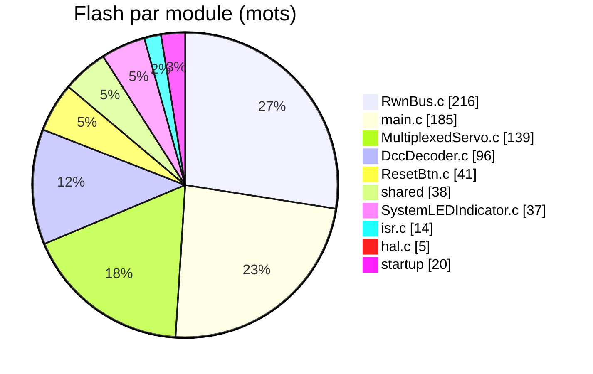
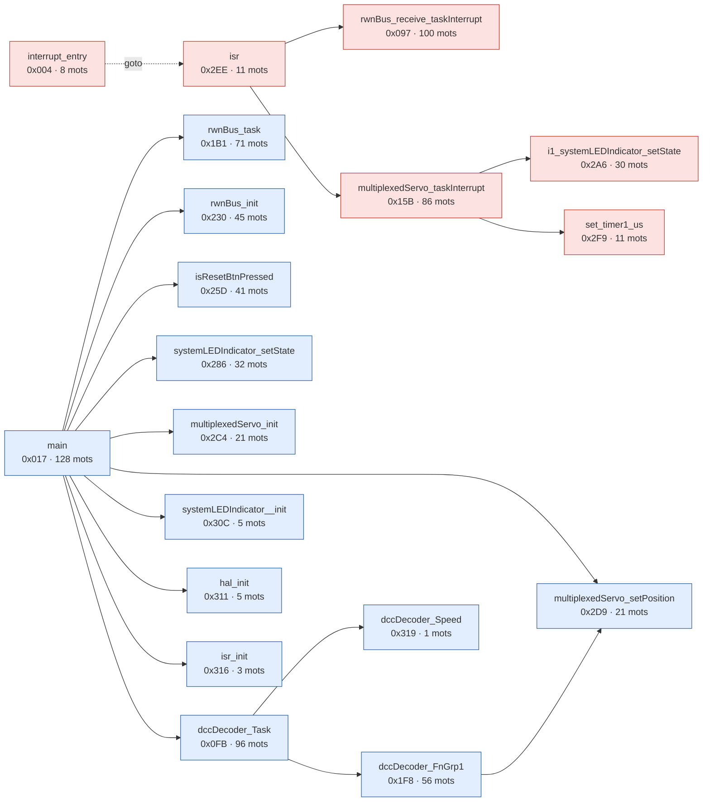

# Rapport firmware : 16F628A

Source : `mem.map` + `StarterBoard.hex`

## 1. Occupation

| Zone | Utilise | Capacite | Libre | Taux |
|---|---:|---:|---:|---:|
| Flash (mots de 14 bits) | 791 | 2048 | 1257 | 38.6 % |
| RAM COMMON | 16 | 16 | 0 | 100.0 % |
| RAM BANK0 | 72 | 80 | 8 | 90.0 % |
| RAM BANK1 | 0 | 80 | 80 | 0.0 % |
| RAM BANK2 | 0 | 48 | 48 | 0.0 % |
| **RAM totale (octets)** | 88 | 224 | 136 | 39.3 % |

> **Attention** : COMMON est pleine (16/16 octets).

## 2. Flash par module et par fonction

| Module | Fonctions | Mots |
|---|---:|---:|
| RwnBus.c | 3 | 216 |
| main.c | 3 | 185 |
| MultiplexedServo.c | 4 | 139 |
| DccDecoder.c | 1 | 96 |
| ResetBtn.c | 1 | 41 |
| shared (runtime) | 2 | 38 |
| SystemLEDIndicator.c | 2 | 37 |
| isr.c | 2 | 14 |
| hal.c | 1 | 5 |
| startup (reset, interruption, init, effacement RAM) |  | 20 |

Les 12 plus grosses fonctions :

| Fonction | Module | Adresse | Mots |
|---|---|---:|---:|
| _main | main.c | 0x017 | 128 |
| _rwnBus_receive_taskInterrupt | RwnBus.c | 0x097 | 100 |
| _dccDecoder_Task | DccDecoder.c | 0x0FB | 96 |
| _multiplexedServo_taskInterrupt | MultiplexedServo.c | 0x15B | 86 |
| _rwnBus_task | RwnBus.c | 0x1B1 | 71 |
| _dccDecoder_FnGrp1 | main.c | 0x1F8 | 56 |
| _rwnBus_init | RwnBus.c | 0x230 | 45 |
| _isResetBtnPressed | ResetBtn.c | 0x25D | 41 |
| _systemLEDIndicator_setState | SystemLEDIndicator.c | 0x286 | 32 |
| i1_systemLEDIndicator_setState | shared (runtime) | 0x2A6 | 30 |
| _multiplexedServo_setPosition | MultiplexedServo.c | 0x2D9 | 21 |
| _multiplexedServo_init | MultiplexedServo.c | 0x2C4 | 21 |

Flash libre : 0x31A-0x7FF (1254 mots)

## 3. RAM : variables globales

| Variable | Zone | Adresse | Octets |
|---|---|---:|---:|
| rwnPacketData | bssBANK0 | 0x043 | 16 |
| txBuf | bssBANK0 | 0x026 | 12 |
| servoPulseSteps | bssBANK0 | 0x032 | 4 |
| trackPowerState | bssBANK0 | 0x036 | 2 |
| currentServo | bssCOMMON | 0x07D | 1 |
| txIdx | bssBANK0 | 0x038 | 1 |
| txLen | bssBANK0 | 0x039 | 1 |
| PacketStartCount | bssBANK0 | 0x03A | 1 |
| BuffTail | bssBANK0 | 0x03B | 1 |
| BuffHead | bssBANK0 | 0x03C | 1 |
| RepeatCmd | bssBANK0 | 0x03D | 1 |
| isPulse | bssBANK0 | 0x03E | 1 |
| decoderState | bssBANK0 | 0x03F | 1 |
| DccCurrentPacket | bssBANK0 | 0x040 | 1 |
| RwnBus_RxPacketLength | bssBANK0 | 0x041 | 1 |
| sh_porta | bssBANK0 | 0x042 | 1 |
| rxLastTime | nvBANK0 | 0x065 | 1 |
| RwnBus_RxPacket | nvBANK0 | 0x066 | 1 |
| dccDecoder_Address | nvBANK0 | 0x067 | 1 |

Taille deduite de l'ecart entre symboles consecutifs (un remplissage eventuel est compte dans la variable qui precede).

Variables d'un bit : `RwnBus_FERR` (0x07B bit 5), `RwnBus_RRDY` (0x07B bit 7), `RwnBus_TRMT` (0x07B bit 2), `TrkPwr_TRMT` (0x07B bit 6), `dccDecoder_ResetMode` (0x07C bit 0)

Variables locales (pile compilee, partagees entre fonctions qui ne s'appellent pas) : cstackCOMMON = 11 octets, cstackBANK0 = 18 octets.

## 4. Graphe d'appels et pile materielle

| Contexte | Niveaux de pile | Chemin le plus profond |
|---|---:|---|
| main (boucle principale) | 3 | main -> dccDecoder_Task -> dccDecoder_FnGrp1 -> multiplexedServo_setPosition |
| interruption (1 niveau pris par l'interruption + appels) | 3 | interruption -> isr -> multiplexedServo_taskInterrupt -> i1_systemLEDIndicator_setState |
| demarrage (avant la boucle, interruptions coupees) | 3 | reset_vec -> end_init -> cinit -> main -> dccDecoder_Task -> dccDecoder_FnGrp1 -> multiplexedServo_setPosition |

**Pire cas = main (3) + interruption (3) = 6 / 8 niveaux : OK** (l'interruption peut survenir au point le plus profond de main).

Bleu : appele depuis `main`. Rouge : appele depuis l'interruption. Violet : les deux. Trait pointille : `goto` (saut de fin de fonction, ne consomme pas de pile).

| Fonction | Niveaux de pile sous elle | Appelle |
|---|---:|---|
| main | 3 | dccDecoder_Task, hal_init, isResetBtnPressed, isr_init, multiplexedServo_init, multiplexedServo_setPosition, rwnBus_init, rwnBus_task, systemLEDIndicator__init, systemLEDIndicator_setState |
| dccDecoder_Task | 2 | dccDecoder_FnGrp1, dccDecoder_Speed |
| isr | 2 | multiplexedServo_taskInterrupt, rwnBus_receive_taskInterrupt |
| interrupt_entry | 2 | isr |
| dccDecoder_FnGrp1 | 1 | multiplexedServo_setPosition |
| multiplexedServo_taskInterrupt | 1 | i1_systemLEDIndicator_setState, set_timer1_us |
| rwnBus_task | 0 | - |
| rwnBus_receive_taskInterrupt | 0 | - |
| multiplexedServo_setPosition | 0 | - |
| systemLEDIndicator__init | 0 | - |
| systemLEDIndicator_setState | 0 | - |
| hal_init | 0 | - |
| set_timer1_us | 0 | - |
| rwnBus_init | 0 | - |
| dccDecoder_Speed | 0 | - |
| multiplexedServo_init | 0 | - |
| i1_systemLEDIndicator_setState | 0 | - |
| isr_init | 0 | - |
| isResetBtnPressed | 0 | - |

Methode : les instructions `CALL` et `GOTO` du .hex sont rattachees aux fonctions par leurs adresses (.map). Un `GOTO` vers une autre fonction n'ajoute pas de niveau. Les appels par pointeur ou par table (PCL) ne sont pas suivis.
