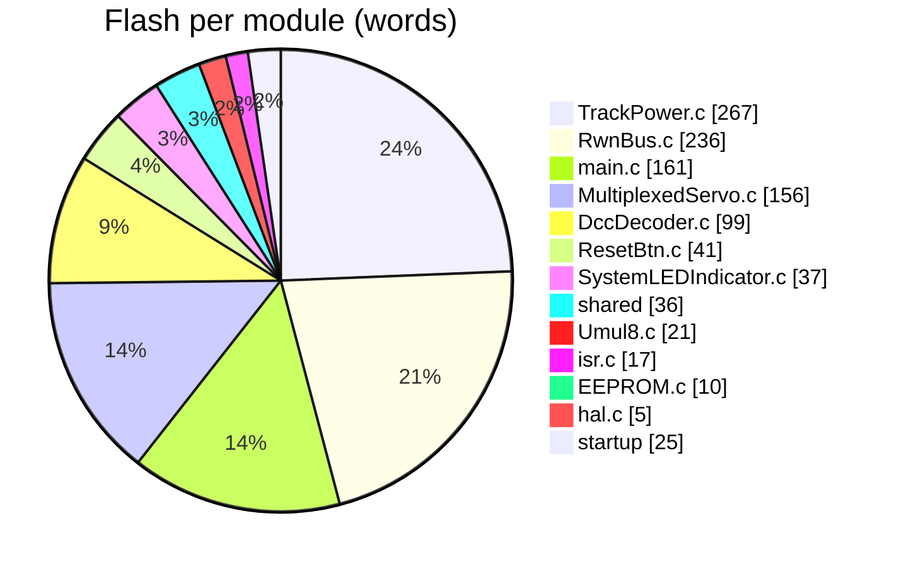
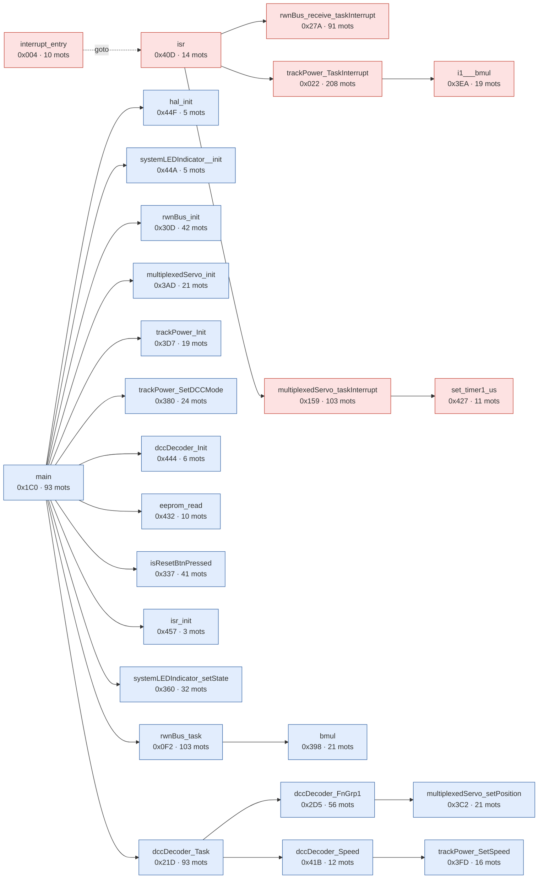

# Rapport firmware : 16F628A

Source : `mem.map` + `StarterBoard.hex`

## 1. Occupation

| Zone | Utilise | Capacite | Libre | Taux |
|---|---:|---:|---:|---:|
| Flash (mots de 14 bits) | 1111 | 2048 | 937 | 54.2 % |
| RAM COMMON | 16 | 16 | 0 | 100.0 % |
| RAM BANK0 | 70 | 80 | 10 | 87.5 % |
| RAM BANK1 | 16 | 80 | 64 | 20.0 % |
| RAM BANK2 | 0 | 48 | 48 | 0.0 % |
| **RAM totale (octets)** | 102 | 224 | 122 | 45.5 % |

> **Attention** : COMMON est pleine (16/16 octets).

## 2. Flash per module and per function

| Module | Fonctions | Mots |
|---|---:|---:|
| TrackPower.c | 4 | 267 |
| RwnBus.c | 3 | 236 |
| main.c | 3 | 161 |
| MultiplexedServo.c | 4 | 156 |
| DccDecoder.c | 2 | 99 |
| ResetBtn.c | 1 | 41 |
| SystemLEDIndicator.c | 2 | 37 |
| shared (runtime) | 2 | 36 |
| Umul8.c | 1 | 21 |
| isr.c | 2 | 17 |
| EEPROM.c | 1 | 10 |
| hal.c | 1 | 5 |
| startup (reset, interruption, init, effacement RAM) |  | 25 |

The 12 largest functions :

| Function | Module | Address | Words |
|---|---|---:|---:|
| _trackPower_TaskInterrupt | TrackPower.c | 0x022 | 208 |
| _multiplexedServo_taskInterrupt | MultiplexedServo.c | 0x159 | 103 |
| _rwnBus_task | RwnBus.c | 0x0F2 | 103 |
| _main | main.c | 0x1C0 | 93 |
| _dccDecoder_Task | DccDecoder.c | 0x21D | 93 |
| _rwnBus_receive_taskInterrupt | RwnBus.c | 0x27A | 91 |
| _dccDecoder_FnGrp1 | main.c | 0x2D5 | 56 |
| _rwnBus_init | RwnBus.c | 0x30D | 42 |
| _isResetBtnPressed | ResetBtn.c | 0x337 | 41 |
| _systemLEDIndicator_setState | SystemLEDIndicator.c | 0x360 | 32 |
| _trackPower_SetDCCMode | TrackPower.c | 0x380 | 24 |
| _multiplexedServo_setPosition | MultiplexedServo.c | 0x3C2 | 21 |

Flash libre : 0x45A-0x7FF (934 mots)

## 3. RAM : variables globales

| Variable | Zone | Adresse | Octets |
|---|---|---:|---:|
| rwnPacketData | bssBANK1 | 0x0A0 | 16 |
| txBuf | bssBANK0 | 0x020 | 6 |
| CVCcache | bssBANK0 | 0x026 | 6 |
| servoPulseSteps | bssBANK0 | 0x02C | 4 |
| dccIdlePacket | dataBANK0 | 0x061 | 3 |
| trackPowerState | bssBANK0 | 0x030 | 2 |
| pDccCurrentPacketByte | bssBANK0 | 0x032 | 1 |
| dccCurrentByte | bssBANK0 | 0x033 | 1 |
| dccPreambleCount | bssBANK0 | 0x034 | 1 |
| dccCurrentPacketLength | bssBANK0 | 0x035 | 1 |
| pDccCurrentPacket | bssBANK0 | 0x036 | 1 |
| txIdx | bssBANK0 | 0x037 | 1 |
| txLen | bssBANK0 | 0x038 | 1 |
| PacketStartCount | bssBANK0 | 0x039 | 1 |
| BuffCommit | bssBANK0 | 0x03A | 1 |
| BuffTail | bssBANK0 | 0x03B | 1 |
| BuffHead | bssBANK0 | 0x03C | 1 |
| RwnBus_RxPacketLength | bssBANK0 | 0x03D | 1 |
| RemainPeriods | bssBANK0 | 0x03E | 1 |
| isPulse | bssBANK0 | 0x03F | 1 |
| currentServo | bssBANK0 | 0x040 | 1 |
| i2cOk | bssBANK0 | 0x041 | 1 |
| fail | bssBANK0 | 0x042 | 1 |
| lastOut | bssBANK0 | 0x043 | 1 |
| ticks | bssBANK0 | 0x044 | 1 |
| state | bssBANK0 | 0x045 | 1 |
| busI2C8xIO_DataIn | bssBANK0 | 0x046 | 1 |
| busI2C8xIO_DataOut | bssBANK0 | 0x047 | 1 |
| decoderState | bssBANK0 | 0x048 | 1 |
| sh_porta | bssBANK0 | 0x049 | 1 |
| dccDecoder_Address | bssBANK0 | 0x04A | 1 |
| rxLastTime | nvBANK0 | 0x064 | 1 |
| pRwnBus_RxPacket | nvBANK0 | 0x065 | 1 |

Estimated size based on the gap between consecutive symbols (any padding is counted in the preceding variable).

Single-bit variables : `RwnBus_FERR` (0x05F bit 6), `RwnBus_RRDY` (0x05F bit 7), `RwnBus_TRMT` (0x05F bit 3), `TrkPwr_TRMT` (0x05F bit 0), `dccDecoder_ResetMode` (0x060 bit 0)

Local variables (compiled stack, shared between functions that do not call each other) : cstackCOMMON = 14 octets, cstackBANK0 = 20 octets.

## 4. Call graph and hardware stack

| Context | Stack Levels | Deepest Path |
|---|---:|---|
| main (main loop) | 3 | main -> dccDecoder_Task -> dccDecoder_FnGrp1 -> multiplexedServo_setPosition |
| interrupt (1 level taken by the interrupt + calls) | 3 | interrupt -> isr -> trackPower_TaskInterrupt -> i1___bmul |
| startup (before the loop, interrupts disabled) | 3 | reset_vec -> end_init -> cinit -> main -> dccDecoder_Task -> dccDecoder_FnGrp1 -> multiplexedServo_setPosition |

**Worst case = main (3) + interrupt (3) = 6 / 8 levels : OK** (the interrupt can occur at the deepest point of the main function).

Blue : called from `main`. Red : called from the interrupt. Purple : both. Dotted line : `goto` (jump at the end of function, does not consume stack).

| Function | Stack Levels under it | Calls |
|---|---:|---|
| main | 3 | dccDecoder_Init, dccDecoder_Task, eeprom_read, hal_init, isResetBtnPressed, isr_init, multiplexedServo_init, rwnBus_init, rwnBus_task, systemLEDIndicator__init, systemLEDIndicator_setState, trackPower_Init, trackPower_SetDCCMode |
| isr | 2 | multiplexedServo_taskInterrupt, rwnBus_receive_taskInterrupt, trackPower_TaskInterrupt |
| dccDecoder_Task | 2 | dccDecoder_FnGrp1, dccDecoder_Speed |
| interrupt_entry | 2 | isr |
| dccDecoder_FnGrp1 | 1 | multiplexedServo_setPosition |
| rwnBus_task | 1 | bmul |
| multiplexedServo_taskInterrupt | 1 | set_timer1_us |
| dccDecoder_Speed | 1 | trackPower_SetSpeed |
| trackPower_TaskInterrupt | 1 | i1___bmul |
| i1___bmul | 0 | - |
| hal_init | 0 | - |
| multiplexedServo_init | 0 | - |
| dccDecoder_Init | 0 | - |
| systemLEDIndicator__init | 0 | - |
| isResetBtnPressed | 0 | - |
| trackPower_Init | 0 | - |
| bmul | 0 | - |
| eeprom_read | 0 | - |
| isr_init | 0 | - |
| trackPower_SetDCCMode | 0 | - |
| trackPower_SetSpeed | 0 | - |
| set_timer1_us | 0 | - |
| systemLEDIndicator_setState | 0 | - |
| rwnBus_receive_taskInterrupt | 0 | - |
| multiplexedServo_setPosition | 0 | - |
| rwnBus_init | 0 | - |

### Points to verify

- call cinit -> idataBANK0+1 (entry at the middle of the function)
- call cinit -> idataBANK0+2 (entry at the middle of the function)

Method : the `CALL` and `GOTO` instructions in the .hex file are linked to functions by their addresses (.map). A `GOTO` to another function does not add a level. Calls by pointer or table (PCL) are not tracked.
