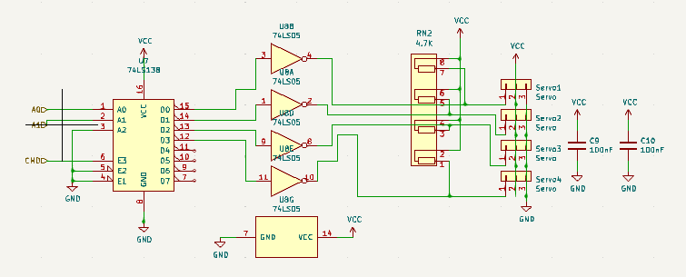
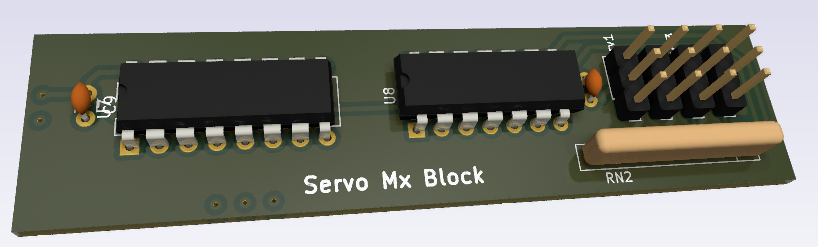

# Mx Servo
The MxSerov block drives up to 4 Servo motors (basic version) using a multiplexed bus, the current revison is 2.0 , with is a stable design version. The design is provided by :
- rwnServoMxBlock.kicad_sch
- rwnServoMxBlock.kicad_pcb

## 1. Overview

This module use a `74LS138` for multiplexing the servo-motors control. As the multiplexing is a low state driver, the output is inversed by a `74LS05`. A resistor net is added for compatibility with open drain outputs of the inversor.

>[!danger] All my schematics are NOT professional skills based. I 'm not responsable for any electronics issues

## 2. Electrical functional Interface
This table gives signals connection list of the `mxServo` block. supply connection are not listed as they can be integrated by a global integration whith bottom and top surfface of the PCB. 

| Broche | Signal | Dir. | Type    | Niveau/plage | Courant max | Remarques        |
| ------ | ------ | ---- | ------- | ------------ | ----------- | ---------------- |
| 1      | CMD    | in   | numeric | 0/5 V        | —           | r.i.s. : L (0 V) |
| 2      | A0     | in   | numeric | 0/5 V        | —           | r.i.s. : L (0 V) |
| 3      | A1     | in   | numeric | 0/5 V        | —           | r.i.s. : L (0 V) |
*r.i.s. :recommended initial state*
## 3. Power and consumtion  
Rails utilisés, tension, consommation typique et maximale, protections (diode, fusible), découplage.

## 4. Functional spécifications 
Protocole et débit (par exemple RS485 à 19200 bauds), temporisations critiques, seuils, limites.

## 5.  Schématics and components information
Capture de la feuille, liste des composants principaux avec valeurs et rôles, calculs importants (résistances de polarisation, filtres).

## 6. PCB Implantation PCB

- Dimensions : 18x76mm
- Connectors :
	-  Power on the left (2 pins)
	-  Mx Bus and cmd at the bottom (3 pins)

## 7. Firmware mapping concept  
Macros de `HardwareProfile.h` utilisées (par exemple `RWNBUS_DE`), capacités DCC activées, fonctions de rappel (« hooks ») à fournir, ressources du MCU consommées (broches, timer, RAM).

## 8.  Setting to Work and Tests  
Mesures à faire, valeurs attendues, procédure de vérification, pannes classiques.

## 9. Change logs et notes

- 2.0 fix pull down reqiered behind invertor (RN2) to provide 5V on servo command pins