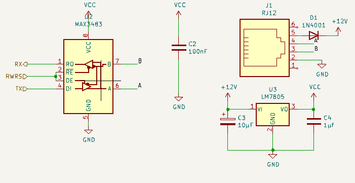
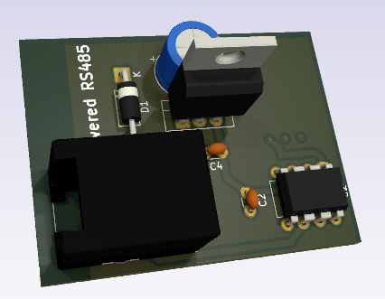

# Powered RS485
The Reset Button block is a maintenance input command for the bord. 
The design is provided by :
- rwnResetBlock.kicad_sch
- rwnResetBlock.kicad_pcb

## 1. Electrical Interface
This table gives signals connection list of the `Reset Button` block. supply connection are not listed as they can be integrated by a global integration with bottom and top surface of the PCB. 

| Broche | Signal | Dir. | Type      | Niveau/plage | Courant max | Remarques  |
| ------ | ------ | ---- | --------- | ------------ | ----------- | ---------- |
| 1      | VCC_5V | out  | alim      | 5 V ±5 %     | 1.2 A       |            |
| 2      | RX     | out  | numérique | 0/5 V        | —           |            |
| 3      | TX     | in   | numérique | 0/5 V        | —           |            |
| 4      | RWRS   | in   | numérique | 0/5 V        | —           | actif haut |
*r.i.s. :recommended initial state*

## 2. Functional spécifications 

This block is design for a software reset implementation. 

- **LM7805** : Provide ,with capacitors (C3,C4), a regulated voltage of 5V up to 1.5A
- **RJ12 plug** : Provide main 12V supply and external control data. 
- **Max3483** : This chip convert RS485 signal to standard usart Rx,Tx. its integration is in half-duplex mode. `RWRS` controls Rx or Tx mode of Max3483.

Preconised configuration for RS485 :
- 19200 bauds 8,n1

## 3.  Schematics and components information

>[!danger] All my schematics are NOT professional skills based. I 'm not responsable for any electronics issues

## 4. PCB Implantation

- Dimensions : 35x40mm
- Connectors :
	-  Power on the top (1 pin for VCC ). the GND is provided by PCB bottom surface
	-  Converted RS485 to Rx,Tx,DE for MCU at the bottom righe (3 pins)

## 5. Firmware mapping concept  
There is not a generic implemented  for this block. The [RwnBus(.h|.c)](https://github.com/BenoitGT/RwnBoardFirmware/blob/main/modules/RwnBus.h) is a specific implementation for this project. 
Use constants definition In `HardwareProfile.h` :
- `RWNBUS_DE` , `RWNBUS_DE_TRIS` : To  link the RWRS(DE) Pin. 
RX and TX are automatically associated to `usart` module of the MCU.

## 6.  Setting to Work and Tests  
Make a standard STW procedure :
- Check output supply : Should be a 5V DC

## 7. Change logs and notes
- 2.0 - 2026-10 : fix supply leak, change LM78LS05 for LM7805 to support up to 1.5 A
- 1.0  - 2018-01 : Initial version

