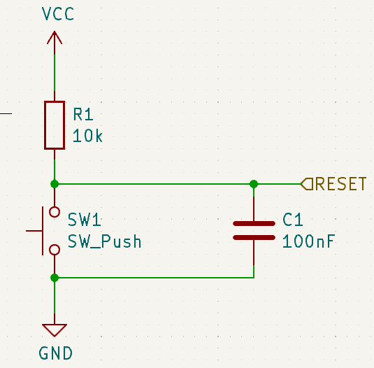
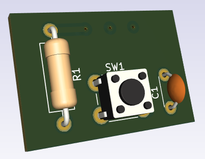

# Reset Button
The Reset Button block is a maintenance input command for the bord. 
The design is provided by :
- rwnResetBlock.kicad_sch
- rwnResetBlock.kicad_pcb

## 1. Electrical Interface
This table gives signals connection list of the `Reset Button` block. supply connection are not listed as they can be integrated by a global integration with bottom and top surface of the PCB. 

| Broche | Signal | Dir. | Type    | Niveau/plage | Courant max | Remarques  |
| ------ | ------ | ---- | ------- | ------------ | ----------- | ---------- |
| 1      | RESET  | out  | numeric | 0/5 V        | —           | r.i.s. : H |
*r.i.s. :recommended initial state*

## 2. Functional spécifications 

This block is design for a software reset implementation. 
## 3.  Schematics and components information

>[!danger] All my schematics are NOT professional skills based. I 'm not responsable for any electronics issues

## 4. PCB Implantation

- Dimensions : 15x20mm
- Connectors :
	-   1 pins `RESET`to drives the reset order to MCU.
	-  2 pins for supply if PCB  global surfaces  are use not suitable.
	

## 5. Firmware mapping concept  
The block driver is implemented in [ResetBtn(.h|.c)](https://github.com/BenoitGT/RwnBoardFirmware/blob/main/modules/ResetBtn.h). Use constants definition In `HardwareProfile.h` :
- `RESET_BT` , `RESET_BT_TRIS_TRIS` : To define mange `RESET` signal

## 6.  Setting to Work and Tests  
Make a standard STW procedure :
- Check input supply : Should be a 5V DC
- Check button pull dwon effect

## 7. Change logs and notes

- 1.0  - 2018-01 : Initial version