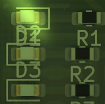
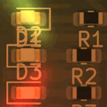
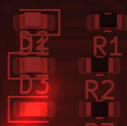
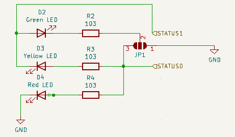
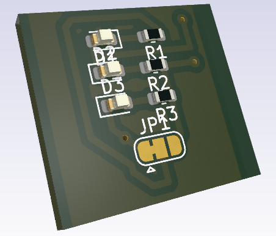

# System LED Indicator
The System LED Indicator block can use up to 3 LED display. this system is used for indicate several board status : `READY`,`BUSY`or `ERROR`.
The design is provided by :
- rwnSLI2Block.kicad_sch
- rwnSLI2Block.kicad_pcb

## 1. Electrical Interface
This table gives signals connection list of the `SLI` block. supply connection are not listed as they can be integrated by a global integration with bottom and top surface of the PCB. 

 
 
System LED Indicator

| Broche | Signal  | Dir. | Type    | Niveau/plage | Courant max | Remarques        |
| ------ | ------- | ---- | ------- | ------------ | ----------- | ---------------- |
| 1      | STATUS0 | in   | numeric | 0/5 V        | 5.25V       | r.i.s. : L (0 V) |
| 2      | STATUS1 | in   | numeric | 0/5 V        | 5.25V       | r.i.s. : L (0 V) |

*r.i.s. :recommended initial state*

## 2. Functional spécifications 
The `STATUS[0-1]` inputs drive 2 bits coding states  for the LEDs layout set. Out puts are define as below : 

| STATUS | Green LED | Yellow LED | Red LED     |
| ------ | --------- | ---------- | ----------- |
| 00     | OFF       | OFF        | OFF         |
| 01     | ON        | OFF        | OFF         |
| 10     | OFF       | OFF        | ON          |
| 11     | ON        | ON(1)      | OFF / ON(2) |
*(1) 3 LEDs wired setup,
(2) Only Green/Red LEDs setup*

| Ready State                            | Busy State                               | Error State                            |
| -------------------------------------- | ---------------------------------------- | -------------------------------------- |
|  |  |  |

## 3.  Schematics and components information
This module use a `JUMPER` for activate the optional `Yellow LED`settup.

>[!danger] All my schematics are NOT professional skills based. I 'm not responsable for any electronics issues

## 4. PCB Implantation

- Dimensions : 15x15mm
- Connectors :
	-   2 pins to drives up to 3 LEDs . the GND is provided by PCB bottom surface

## 5. Firmware mapping concept  
The block driver is implemented in [SystemLEDIndicator(.h|.c)](https://github.com/BenoitGT/RwnBoardFirmware/blob/main/modules/SystemLEDIndicator.h). Use constants definition In `HardwareProfile.h` :
- `SLI_STATUS0` , `SLI_STATUS0_TRIS` : To define mange `STATUS0`
-  `SLI_STATUS1` , `SLI_STATUS1_TRIS` : To define mange `STATUS0`

## 6.  Setting to Work and Tests  
Make a standard STW procedure :
- Check input supply : Should be a 5V DC
- Check each LED/Resistor chain 

## 7. Change logs and notes

- 1.0  - 2018-01 : Initial version
