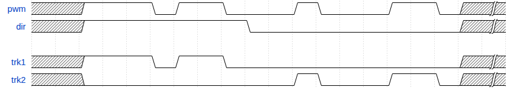
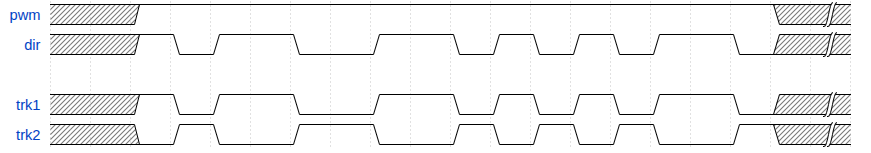
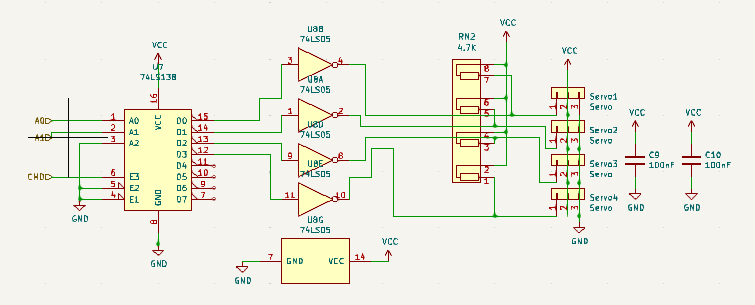
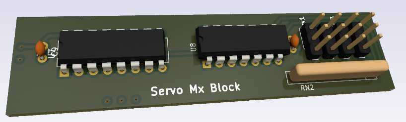

# Track Power
The Track Power block use to Mofset transistor for high performance power control. This block allows 2 features : A Analogical power supply using ulse with modulation (pwm). and a Digital mode forwarding DCC commande from rwnBus.
The design is provided by :
- rwnServoMxBlock.kicad_sch
- rwnServoMxBlock.kicad_pcb

## 1. Electrical Interface
This table gives signals connection list of the `mxServo` block. supply connection are not listed as they can be integrated by a global integration with bottom and top surface of the PCB. 

| Broche | Signal | Dir. | Type    | Niveau/plage | Courant max | Remarques        |
| ------ | ------ | ---- | ------- | ------------ | ----------- | ---------------- |
| 1      | CMD    | in   | numeric | 0/5 V        | 5.25V       | r.i.s. : L (0 V) |
| 2      | A0     | in   | numeric | 0/5 V        | 5.25V       | r.i.s. : L (0 V) |
| 3      | A1     | in   | numeric | 0/5 V        | 5.25V       | r.i.s. : L (0 V) |
*r.i.s. :recommended initial state*

## 2. Functional spécifications 
The `cmd` input drives pwm signal for servos lines and `A0A1` are used to select the target line.

### Analogical mode

### Digital Mode

## 3.  Schematics and components information
This module use a `74LS138` for multiplexing the servo-motors control. As the multiplexing is a low state driver, the output is unversed by a `74LS05`. A resistor net is added for compatibility with open drain outputs of the inverser.

>[!danger] All my schematics are NOT professional skills based. I 'm not responsable for any electronics issues

## 4. PCB Implantation

- Dimensions : 18x76mm
- Connectors :
	-  Power on the left (2 pins)
	-  Mx address Bus(`A[0-1]`) and `cmd` at the bottom (3 pins)   

## 5. Firmware mapping concept  
The block driver is implemented in [MultiplexedServo(.h|.c)](https://github.com/BenoitGT/RwnBoardFirmware/blob/main/modules/MultiplexedServo.h). Use constants definition In `HardwareProfile.h` :
- `MX_SERVO_PIN` , `MX_SERVO_PIN_TRIS` : To define `CMD`pin 
-  `MX_SERVO_SEL_PORT`,`MX_SERVO_SEL_SHIFT` : For `A[0-1]`access
-  `MX_SERVO_SEL_SH_PORT` : for sharing `A[0-1]` port use with others bocks

For software PWM feature the driver use `Timer1`of the MCU.

## 6.  Setting to Work and Tests  
Make a standard STW procedure :
- Check input supply : Should be a 5V DC
- Check each servo supply : Should be a 5V DC
- Check default state : while no PWM order servo PWM pin should be a 0V

## 7. Change logs and notes

- 2.0 - 2026-10 : fix pull down reqiered behind invertor (RN2) to provide 5V on servo command pins
- 1.0  - 2018-01 : Initial version