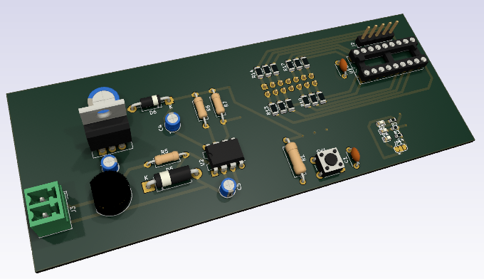

# SignalBoard

## 1. Electrical Interface

## 2. Functional spécifications 

## 3.  Schematics and components information

## 4. PCB Implantation

## 5. Firmware mapping concept  

## 6.  Setting to Work and Tests  
## 7. Change logs and notes

- 1.0  - 2018-01 : Initial version
