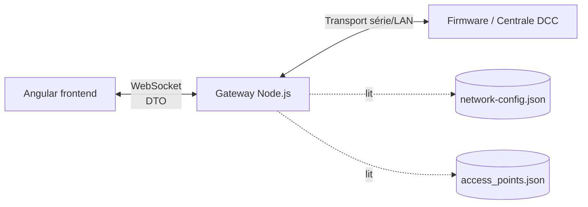

---
tags:
  - sdd
  - moc
  - dcc-control-app
banner: "[[microchip_banner.png]]"
banner_y: 70
---

# Railway Network Firmware Boards — SubSystems Design Document 

> [!info] About
> Structured sumary of sevral topics arounds **Railway Network Firmware Boards**  project , a Microchip MCU based project.  Boards and firmware ares based on a moduluard conception for reuse purpose.
>
> Firmware parts have been reviewed whith *Claude* (Anthropic) for code optitimisation approche.
> Exchanges and choices validated by this IA help are notice in theses notes.   

# Notes Map 

### Fondations
- [[01-Vision-et-Contexte]] — goals, POC perimeter, constraints
- [[02-Modular Architecture]] — structure du repo, workspaces npm
- [[03-Convention-Nommage]] — RawConfig*/*/*Dto, family, suffixes

### Domaine métier
- [[04-Modele-Domaine-Config]] — Decoder, Accessory, Locomotive, Zone, Sector
- [[05-Accessory-Generique]] — modèle générique range/enum/flags, extensibilité
- [[06-Topologie-Graphe]] — zones=arêtes, signaux/aiguillages=nœuds, toe/heel

### Communication bas niveau
- [[07-Communication-Serie]] — Transport / FrameCodec / Protocol, encodage NMRA

### Interfaces
- [[08-Contrat-WebSocket]] — contrat client/serveur, streaming
- [[09-Frontend-Angular]] — services, signals, composants

### Transverses
- [[10-Asynchronicite-et-Robustesse]] — état pending, file de commandes, timeouts
- [[11-Journal-Decisions]] — journal chronologique des décisions (ADR-like)

## Vue d'ensemble rapide

Trois couches, trois vocabulaires distincts (voir [[03-Convention-Nommage]]) :
`RawConfig*` (fichiers) → modèle interne (gateway) → `*Dto` (exposé au frontend).
